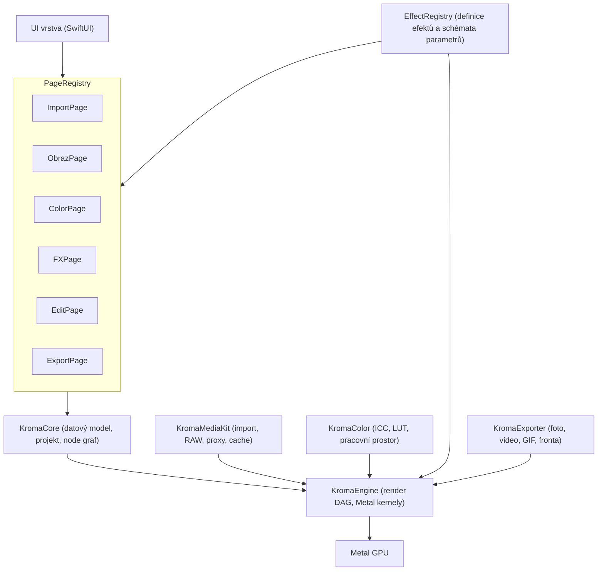

# Kroma – kompletní projektová specifikace

Pracovní název aplikace je Kroma (od slova chroma, tedy barevnost). Název lze kdykoliv změnit, nemá vliv na architekturu.

Tento dokument je určen jako jediný vstup pro programování pomocí CLI agenta. Obsahuje vizi produktu, kompletní funkční specifikaci, návrhy vylepšení oproti původnímu plánu, technickou architekturu, strukturu repozitáře, prioritizovanou roadmapu a kritéria přijetí pro každý milník.

## 1. Vize a cíle

Aplikace pro nedestruktivní úpravu fotografií a videí pro macOS, určená pro jednoho autora (fotograf, kameraman). Minimalistické rozhraní ve stylu Capture One se strukturou stránek v dolním docku jako v DaVinci Resolve.

Klíčové zásady:

1. Nedestruktivita: originální soubory se nikdy nepřepisují. Veškeré úpravy jsou uzly v editačním grafu uloženém v projektu.
2. Rychlost: plynulá práce i na slabším MacBooku díky adaptivnímu rozlišení náhledu, odloženému plnému renderu a cache.
3. Rozšiřitelnost: každá stránka, každý efekt a každý exportní formát je samostatný modul zaregistrovaný v centrálním registru. Funkce lze přidávat a odebírat bez zásahu do zbytku aplikace.
4. Přesnost barev: interní lineární pracovní prostor, ICC profily pro tisk a web, soft proofing.
5. Lokalita a soukromí: aplikace běží plně offline, žádná telemetrie, žádný účet.
6. Dva pracovní režimy: výchozí galerijní fotoeditor a volitelný režim Resolve, ve kterém je celý projekt jedna timeline (kapitola 5). Oba režimy sdílejí totýž node engine a formát projektu.

Cílové zařízení: Apple Silicon MacBook (primárně MacBook Air, tedy i passivně chlazený čip bez ventilátoru). Minimální systém macOS 14 Sonoma.

## 2. Návrhy vylepšení oproti původnímu plánu

Toto jsou konkretizace a doplňky, které v původním plánu chyběly, ale jsou pro dosažení cílů klíčové. Číslované body jsou v souladu s kapitolou 13 zařazeny do roadmapy.

1. Jeden jednotný renderovací engine pro stránky Obraz, Color i FX. Stránka Obraz je jen přednastavená sada uzlů, Color přidá barevné uzly a FX rasterické uzly. Neexistuje tedy trojitý duplicitní kód a existuje jasné rozhraní pro přidávání efektů.
2. Culling v importu: hodnocení 1 až 5 hvězd, barevné štítky, příznak zamítnutí, celoobrazovková prezentace s klávesami pro rychlé vyřazování nevydařených snímků.
3. Kopírování a vkládání úprav mezi snímky, hromadné aplikování úprav, virtuální kopie (varianty jednoho snímku bez duplikace dat).
4. Historie úprav a globální undo/redo napříč všemi stránkami projektu.
5. Import a export LUT souborů (.cube) a uživatelských presetů; opakovatelné exportní presety (web, sociální sítě, tisk, GIF).
6. Exportní fronta na pozadí: uživatel pokračuje v práci, exporty běží v nízké prioritě vláken.
7. Proxy média pro videa (půlrozlišovací proxy při importu 4K materiálu) a pro RAW soubory (rychlé JPEG náhledy pro culling).
8. Explicitní podpora RAW formátů včetně Fujifilm RAF s X-Trans senzorem (vlastní demosaicing přes LibRAW, nikoliv jen systémový dekodér).
9. Depth map: kromě ručního režimu import vestavěné hloubkové mapy z HEIC souborů z iPhonu a odhad hloubky modelem Core ML (Depth Anything v2 small), pokud mapa neexistuje.
10. Soft proofing pro tisk s výběrem ICC profilu, simulace papíru a výpočet cílového PPI pro zvolený formát papíru.
11. Zpětný zápis XML sidecar (XMP) vedle originálů, aby úpravy přečetly ostatní aplikace (Lightroom, Capture One).
12. Automatické ukládání projektu a verzování přes macOS Versions, žádný ztracený zámek souboru.
13. Klávesové zkratky ve stylu DaVinci Resolve (číselné přepínání stránek, například Shift+2 pro stránku Obraz) s plnou editací v nastavení.
14. Termální ochrana jako viditelný stav: ikona tepla v hlavičce, automatický Eko režim při přehřátí (řízené snížení nároků náhledu), ručně zapnutelný Nízký odběr pro práci na baterii.
15. GIF je doplněn o export animovaného WebP a MP4, protože WebP má podstatně menší velikost při stejné kvalitě.
16. Metadata panel (EXIF) jako volitelný overlay v prohlížeči, vypnutý implicitně kvůli minimalismu.
17. Volitelný režim Resolve: celý projekt jako jedna timeline z fotografií, adjustment clipy, textové klipy a barevné štítky ve stylu DaVinci Resolve, node tree ve stránce Color beze změny. Podrobně kapitola 5.

## 3. Uživatelské rozhraní

### 3.1 Celkový layout

- Jeden hlavní okno, tmavé pozadí, žádné zbytečné linky.
- Dolní dock ve stylu DaVinci Resolve: ikony s popisky, aktivní stránka podbarvená akcentovou barvou s kurzorem (underline). Výška přibližně 56 pt, popisek 10 pt.
- Hlavička okna: název projektu, cesta ke složce, stav cache, indikátor tepla (viz kapitola 8), tlačítko fullscreen.
- Levý panel: seznam médií (klient, složka). Pravý panel: inspektor vlastností aktuální stránky. Oba skryvatelné klávesami, aby neomezovaly minimalistický dojem.
- Prohlížeč uprostřed: snímek nebo video, mezerníkem fullscreen uvnitř okna aplikace, klávesou L dočasný náhled originálu.

### 3.2 Stránky (celkem 6, v docku kontextově 5)

| # | Stránka | Klávesa | Viditelnost |
|---|---------|---------|-------------|
| 1 | Import | 1 | vždy |
| 2 | Obraz | 2 | vždy (fotografie) |
| 3 | Color | 3 | vždy |
| 4 | FX | 4 | vždy |
| 5 | Edit | 5 | projekt s videem, animací z fotografií, nebo projekt v režimu Resolve |
| 6 | Export | 7 nebo E | vždy |

Stránka Edit se v docku zobrazí automaticky, jakmile projekt obsahuje videoklip, nebo uživatel vytvoří sekvenci z vybraných fotografií (GIF nebo animace). V režimu Resolve (kapitola 5) je stránka Edit výchozí a v docku vždy viditelná. U čistě fotografického projektu v galerijním režimu dock obsahuje pět položek. Stránka Export automaticky přepíná mezi fotografickým a videoovým panelem podle typu aktuálního média.

### 3.3 Design system

Minimalismus ve stylu Capture One: tmavé panely, vysoký kontrast textu, tenké oddělovače 1 pt, žádné stíny a gradienty ve stylu macOS, jednotný radius panelů 4 pt.

Definovaná paleta (tokeny v kódu, žádné natvrdo zapsané barvy):

| Token (kód) | Hodnota | Použití |
|-------------|---------|---------|
| `bg.base` | #0D0E0F | pozadí aplikace |
| `bg.panel` | #151719 | panely, inspektor |
| `bg.elevated` | #1C1F22 | vyskakovací menu, modály |
| `separator` | #26282B | linky |
| `text.primary` | #F4F4F2 | hlavní text |
| `text.secondary` | #A6A8AA | popisky, hodnoty |
| `accent.green` | #185238 | dominantní tmavě zelená, aktivní stavy |
| `accent.green.hover` | #2AA06B | hover, posuvníky, výběr |
| `accent.red` | #D9483B | odmítnutí, smazání, varování |
| `accent.blue` | #2F6FB5 | informace, výběr v timeline |

Všechny dvojice textu a pozadí musí mít kontrast alespoň 4.5:1. Dominantní barva aplikace a vzhled pozadí jsou uživatelem konfigurovatelné (viz kapitola 8), paleta výše je výchozí.

Typografie: systémové písmo SF Pro, hodnoty a čísla v SF Pro Mono s tabulárními číslicemi u posuvníků.

### 3.4 Komponenty

- Posuvníky s dvojitým kliknutím pro reset na výchozí hodnotu, číselným vstupem a klávesovou navigací.
- Barevná kola (Lift, Gamma, Gain, Offset) se středovými úchyty a zobrazením číselných hodnot.
- Node tree: horizontální pás uzlů, přetahování, kontextové menu na každém uzlu.
- Nástroje prohlížeče: lupa, ruční posun, picker barvy, měřicí sondy.
- Scopes jako přepínatelný overlay v prohlížeči: histogram, vektorskop, RGB parade, waveform.

## 4. Specifikace stránek a funkcí

### 4.1 Stránka Import

Úkol: rychlé procházení složky, culling a výběr materiálu do projektu.

Funkce:

1. Správa složky: výběr složky přes panel, sledování změn na disku (FSEvents), tlačítko pro zobrazení složky ve Finderu.
2. Mřížka náhledů s plynulým virtuálním scrollováním, relativní prioritou načítání viditelných dlaždic, stavový indikátor na každé dlaždici.
3. Nástroje výběru: šipky, Shift a kliknutí, Option s obdélníkovým výběrem, výběr podle hodnocení nebo štítku.
4. Culling: hodnocení 1 až 5 (klávesy 1 až 5), barevné štítky (klávesy 6 až 9), zamítnutí klávesou X. Zamítnuté lze hromadně skrýt, nebo přesunout do koše (s potvrzovacím dialogem, nikoliv trvalým smazáním).
5. Třídící a filtrovací lišta: podle data, hodnocení, typu souboru, štítku.
6. Import zvolených snímků do projektu (implicitně bez kopírování, projekt odkazuje na původní cesty, s možností zapnout kopírování do spravované knihovny).
7. Při importu se generují cache JPEG náhledy a, u videí, proxy v půlrozlišení.

Podporované formáty: JPEG, HEIC, PNG, TIFF, WebP, GIF, RAW (CR3, NEF, ARW, RAF včetně X-Trans, DNG, ORF), video MP4 a MOV (H.264, HEVC, ProRes 422 a 4444), audio pro video (AAC, PCM).

### 4.2 Stránka Obraz (základní úprava)

Sada základních korekčních uzlů, uspořádaných jako jeden lineární node chain:

1. Expozice (EV, rozsah plus minus 5, jemný krok 0.01).
2. Jas (brightness, jiné zakřivení tonální křivky než expozice).
3. Kontrast (střed 0.435 v lineárním prostoru, parametr soft roll-off).
4. Světlá (highlights) a stíny (shadows) s parametry rozsah (range) a plynulost (soft).
5. Bílé a černý bod (whites, blacks).
6. Clarity (střední frekvence, odděleně světlá a tmavá strana mikrokontrastu).
7. Texture (mikrokontrast s jemnější frekvencí než clarity).
8. V pozdější verzi: dehaze, vinětace, ostření s maskou threshold.

Každý parametr: dvojklik reset, číselný vstup, vizualizace šipek, historie změn. Stránka zobrazí před a po (podržení klávesy zpětného lomítka jako v Lightroomu dočasně zobrazí originál).

### 4.3 Stránka Color (pokročilý colorgrading)

1. Základní: saturace, vibrance (s ochranou pleti a sytosti), teplota a odstín.
2. Selektivní korekce (qualifier): výběr podle barvy se třemi knoby (hue, saturace, luminance) s tolerancí a měkkostí hrany, s náhledem masky jako overlay.
3. Balanční kola (balance wheels): Lift, Gamma, Gain, Offset, každé s odstínem (hue) a silou (strength), zobrazením číselných hodnot a master barvou venkovního prstence.
4. Křivky: luminanční, červená, zelená, modrá.
5. NODE TREE: hlavní funkce stránky. Lineární řetěz uzlů na každém snímku, každý uzel nese jeden korekční modul a vlastní masku výběru. Uzly lze přesouvat, zakazovat, kopírovat mezi snímky a seskupovat do skupin. Pozdější verze přidá paralelní větve a míchací uzly (mixer node).
6. Import LUT (.cube) jako uzel, export aktuálního řetězu jako preset nebo LUT.
7. Scopes: histogram, waveform, parade, vektorskop, číselné barevné hodnoty v bodě pod podrženým pickerem.

### 4.4 Stránka FX

Rasterické efekty s podrobným nastavením. Každý efekt je uzel ve stejném grafu jako Color, s vlastní maskou a mixem (originál versus efekt na posuvníku).

Efekty v první verzi:

1. Klasický raster (halftone): velikost bodu, úhel rastru, tvar (kruh, čtverec, linka), zahuštění, úhel na barevný kanál v CMYK režimu (screen angle per channel).
2. Pixel raster: velikost pixelu, hloubka bitů (posterizace), dithering (ordered, noise, error-diffusion), paleta omezená na vybrané barvy.
3. Písmenný raster: snímek je složen z vybraného písmene. Parametry: font, velikost, hustota (density), zjasnění (otevření písmene u světlých tónů), rotace, jas písma, případně zrcadlení písmen u světelných odlesků. Náhled v reálném čase na GPU.
4. Kombinovaný písmenný raster: dvě a více písmen střídaných podle jasového pásma (tmavší písmeno pro stíny, světlejší pro světla), s nastavitelnými prahy pásem.
5. Barevný režim rastru: jednobarvý (duotone se dvěma zvolenými barvami) versus plná barva v CMY rastru (čtyři úhly, samostatný rastr na jednotlivé kanály).
6. Depth map: import hloubkové mapy (PNG grayscale, nebo vestavěná z HEIC), nebo odhad pomocí Core ML. Použití: struktura rastru podle hloubky (větší body v popředí), a režim zploštění scény (Flatten) přes vysunutí a rozostření pozadí podle hloubky, takže předmět vynikne, i když se v původním snímku ztrácel.

Depth map pipeline je samostatný uzel (Depth Node), který produkuje mapu jako virtuální kanál. Kanál lze v jiných efektech využít jako vstup masky podle hloubky.

### 4.5 Stránka Edit (timeline)

Zobrazí se pouze u video projektu nebo sekvence z fotografií. Timeline engine této stránky je základem i pro volitelný režim Resolve (kapitola 5), včetně adjustment clipů a textových klipů.

1. Timeline s jednou video stopou, jednou audio stopou v MVP verzi, více stop v pozdější verzi.
2. Fotografický režim: kladení vybraných snímků na timeline s nastavitelnou dobou zobrazení a přechodem (cut, dissolve), určené pro GIF nebo animaci. Každý snímek nese svůj node chain z Color a FX.
3. Režim pro video: razor (Cmd+B), přesouvání klipů, trim in a out, snapping, označení rozsahu (in a out), rychlost klipu (speed ramp později).
4. Thumbnaily klipů v timeline na pevných intervalech.
5. Playback přes AVFoundation s proxy médiem; efekty se renderují v reálném čase přes stejný node engine na aktuální snímek.
6. Audio: hlasitost klipu, fade in a fade out, zatím bez mixéru.

### 4.6 Stránka Export

Panel se automaticky přepíná podle typu média: fotografický panel, nebo video panel, nebo panel animace (GIF, WebP, MP4 z fotografické sekvence).

Fotografie:

| Parametr | Volby |
|----------|-------|
| Formát | JPEG, PNG, TIFF, HEIC, WebP |
| Kvalita | 0 až 100 (JPEG, WebP), ztrátová, nebo bezztrátová |
| Komprese | LZW (TIFF), DEFLATE (PNG), HEVC varianta HEIC |
| Barevný prostor | sRGB, Display P3, Adobe RGB, vlastní ICC profil |
| Stupně šedi | převod s volbou koeficientů (sRGB luma, percepční) |
| Rozlišení | originál, vlastní, dlouhá strana, krátká strana |
| Tisk | formát papíru (A3, A4, 10x15 cm a další), cílové PPI s kontrolou dostatečného rozlišení, ořez se simulací, přidání okraje (bleed), ICC profil tiskárny se soft proofingem |
| Velikost souboru | cílová maximální velikost (binární vyhledávání kvality), určeno pro odeslání klientovi |
| Hromadnost | export všech vybraných snímků, pojmenování vzorem (prefix, sufix, číslování) |

Video:

| Parametr | Volby |
|----------|-------|
| Kontejner | MP4, MOV |
| Codec | H.264, HEVC 10 bit, ProRes 422, ProRes 4444 |
| Datový tok | kb/s nebo Mb/s, volba jednoho, nebo dvou průchodů |
| Rozlišení | originál, nebo volba z běžných (4K, 1080p, 720p) |
| Snímková frekvence | původní, 60, 30, 24 |
| Audio | AAC, PCM, datový tok |
| Rozsah | celý timeline, nebo označený rozsah |

Animace:

- GIF s paletou 256 barev, dithering, délkou klipu a snímkovou frekvencí.
- Animovaný WebP a MP4 jako alternativy s podstatně menší velikostí.

Společné: exportní presety (uložit a vložit nastavení), exportní fronta na pozadí s nízkou prioritou vláken.

## 5. Režim Resolve (volitelný timeline-first pracovní režim)

Druhý pracovní režim aplikace, inspirovaný pracovní plochou DaVinci Resolve. Určený pro práci se sériemi fotografií, kde má jednotná úprava pokrýt celou sekvenci a fotografie mají být skládány jako střih. Režim je plně volitelný; projekt, který ho nepoužívá, funguje jako běžný galerijní fotoeditor podle kapitol 3 a 4.

### 5.1 Vize režimu

1. Celý projekt je jedna timeline, na které se upravují fotografie. Fotografie jsou na timeline klipy s dobou zobrazení, pořadím a přechody.
2. Dock stránek zůstává zachován. Stránka Edit se stává výchozí a nelze ji skrýt; stránky Obraz, Color a FX pracují s klipem, který je právě vybraný na timeline.
3. Oba režimy sdílejí totéž datové jádro. Klip na timeline nese tentýž node graf jako snímek v galerijním režimu, proto přepnutí režimu projektu nepřevádí žádná data, pouze mění pohled pracovního prostoru.
4. Výchozí režim nových projektů se volí v nastavení (kapitola 8, sekce Pracovní prostředí). Režim existujícího projektu lze přepnout kdykoliv v menu Projekt. Když uživatel v galerijním režimu vytvoří sekvenci z vybraných snímků, aplikace přepnutí do režimu Resolve nabídne.

### 5.2 Timeline z fotografií

1. Stopy v první verzi: foto (fotografie jako klipy), adjustment (adjustment clipy) a text (textové klipy). Audio stopa se přidá s podporou videa.
2. Operace s klipy: doba zobrazení, trim in a out, přesouvání tažením, snapping, razor (Cmd+B), označení rozsahu (I a O), změna pořadí.
3. Přechody: cut a dissolve v první verzi, další (wipe, dip to black) později.
4. Barevné štítky klipů z palety osmi barev ve stylu DaVinci Resolve pro orientaci v sekvenci. Štítek je výhradně vizuální označení a nemá vliv na obraz ani na grade.
5. Timecode, plynulý zoom timeline (gesta trackpadu) a mini navigační lišta nad timeline.

### 5.3 Adjustment clipy

1. Adjustment clip je speciální klip na vlastní stopě, který nese vlastní node chain (libovolné uzly z Color i FX) a aplikuje ho na všechny foto klipy pod sebou v celém svém časovém rozsahu.
2. Hlavní smysl: jednotná úprava celé série snímků jedním zásahem, například jednotná expozice a barevnost celé dení sekvence, bez kopírování grafu do každého snímku zvlášť.
3. Vlastnosti adjustment clipu: název, barevný štítek, aktivace a deaktivace jedním klikem, mix (poměr mezi původním obrazem klipu a obrazem po adjustmentu), časový rozsah. Deaktivovaný adjustment clip se v renderu neprojeví vůbec.
4. Výsledný obraz: na vybraný čas nejdříve proběhne node graf foto klipu, poté node chainy všech aktivních adjustment clipů sahajících na tento čas, v pořadí od horní stopy dolů.
5. Adjustment clip lze uložit jako preset a znovu použít v jiném projektu.

### 5.4 Textové klipy

1. Textový klip na textové stopě: obsah, font, velikost, barva, pozice, zarovnání, ohraničení, stín, doba trvání, fade in a fade out.
2. Základní animace (průhlednost, posun) v první verzi. Šablony a klíčované animace později.
3. Text se do obrazu dostává jako Text Node v node grafu, takže podléhá stejné správě barev a může být dále upravován uzly jako kterákoli jiná vrstva.
4. Volitelný overlay bezpečných zón (title safe).

### 5.5 Node tree ve stránce Color

1. Stránka Color v režimu Resolve nabízí totéž rozhraní jako v galerijním režimu: balanční kola, saturaci, vibrance, qualifier, křivky, LUT a kompletní node tree.
2. Vybraný adjustment clip se na stránce Color chová jako plnohodnotný nosič grafu: jeho node chain se edituje přímo a změna se okamžitě projeví na celém označeném rozsahu.
3. Uzly lze přidávat, přesouvat, zakazovat a seskupovat stejně jako v galerijním režimu. Grafy lze kopírovat mezi klipy a adjustment clipy.
4. Klíčové snímky parametrů uzlů v čase (keyframing) na adjustment clipu jsou až za první verzí, určené pro plynulé proměny grade v rámci sekvence.

### 5.6 Náhledy

1. Hlavní prohlížeč v obou režimech vždy zobrazí celou vybranou fotografii v režimu fit, nikdy jen výřez. Zvětšení lupou se vztahuje k rozlišení snímku, nikoliv k timeline.
2. Mini náhled timeline: ve stránkách Obraz, Color a FX se pod hlavním prohlížečem zobrazí zmenšený filmstrip celé timeline s miniaturami klipů, barevnými pruhy adjustment a textových klipů a značkou aktuální pozice. Kliknutí na miniaturu vybere klip.
3. Filmstrip lze kdykoliv skrýt (klávesa T), nebo trvale vypnout v nastavení (kapitola 8, sekce Pracovní prostředí). Standardní pracovní plocha tak zůstane minimalistická a filmstrip se zobrazuje jen v režimu Resolve, kde ho uživatel potřebuje.
4. Ve stránce Edit je hlavní timeline pracovní plochou a miniaturu vybrané fotografie zobrazuje inspektor vpravo.

### 5.7 Klávesové zkratky režimu

V režimu Resolve aplikace předvolí zkratky ve stylu DaVinci Resolve: J a L přetočení (opakovaným stiskem zrychlení), K zastavení, mezerník playback, I a O označení rozsahu, Cmd+B razor, šipky posun po klipích. Kteroukoliv zkratku lze přemapovat (kapitola 8, sekce Klávesové zkratky).

## 6. Správa barev

1. Interní pracovní prostor: lineární, scénově referovaný, half float (16 bit) na GPU. Barevný prostor souboru se deklaruje při importu z ICC profilu v metadatech.
2. Zobrazování: převod do barevného prostoru displeje přes ColorSync, podpora XDR displejů.
3. Tisk: převod do zvoleného ICC profilu tiskárny s black point compensation, soft proofing v prohlížeči (simulace papíru).
4. Web: export do sRGB, aby barvy odpovídaly všude.
5. V nastavení volba pracovního prostoru (výchozí Display P3).

## 7. Výkon, adaptivní renderování a termika

Toto je jádro plynulosti aplikace. Princip: renderovat vždy jen to, co uživatel právě vidí, v takovém rozlišení, které stíhá GPU, a plné rozlišení počítat pouze na exportu.

### 7.1 Adaptivní rozlišení náhledu

1. Náhled se vždy renderuje v rozlišení panelu prohlížeče (fit), nikoliv v plném rozlišení snímku.
2. Při interakci (tažení posuvníku) se rozlišení sníží na polovinu, po skončení interakce se renderuje plný náhled v plné kvalitě.
3. Render v plném rozlišení se počítá odloženě na pozadí, pouze pokud uživatel náhled zvětší přes 100 procent.

### 7.2 Cache a dlaždicování

1. Cache renderovaných náhledů v balíčku projektu, klíčem je hash node grafu plus verze zdrojového souboru.
2. Interaktivní render dlouhých efektů: nejdříve rychlý přibližný výsledek, po dokončení kompletní verze.
3. Při práci s videem se renderuje jen aktuální snímek, s mezipamětí dlaždic na timeline (tile caching).

### 7.3 Prevence přehřátí

1. Sledování `ProcessInfo.processInfo.thermalState` (nominal, fair, serious, critical) na macOS.
2. Při přechodu na serious a critical: automatické snížení rozlišení náhledu, pozastavení renderu na pozadí, pozastavení generování proxy, omezení exportu na jednu úlohu.
3. Indikátor v hlavičce aplikace: barevná tečka (zelená, oranžová, červená) s vysvětlivkou v nastavení.
4. Eko režim jako trvalá volba v nastavení, určený pro MacBook Air bez ventilátoru.
5. Napájení: při provozu na baterii lze automaticky zapnout Eko režim.

### 7.4 Detekce výkonu zařízení

1. Při prvním spuštění aplikace se spustí krátký benchmark GPU (render zkušebního snímku s typovým efektem), výsledek se uloží jako výkonová úroveň 1 až 3.
2. Podle úrovně se volí: rozlišení náhledu, práh pro snížení kvality při interakci, počet vláken pro export, velikost vyrovnávací paměti cache.
3. Uživatel může úroveň přepsat ručně v nastavení.

## 8. Nastavení

Ikona ozubeného kola trvale v pravém dolním rohu aplikace. Po rozkliknutí se otevře modální okno s vyhledávacím polem nahoře a levým bočním seznamem sekcí. Nastavení se ukládá průběžně a platí okamžitě, bez tlačítka potvrdit. Vyhledávací pole zobrazí, ve které sekci se hledané nastavení nachází.

### 8.1 Struktura nastavení

| Sekce | Obsah |
|-------|-------|
| Pracovní prostředí | Výchozí pracovní režim nových projektů (Galerie, Resolve), motiv (tmavý výchozí, grafitový, světlý), dominantní barva aplikace z tmavších odstínů (tmavě zelená výchozí, tmavě červená, tmavě modrá, grafitová) s možností zadat přesnou hex hodnotu, velikost ovládacích prvků (kompaktní, standard), chování bočních panelů, zapnutí a vypnutí mini náhledu timeline (viz 5.6). |
| Výkon a systém | Výkonová úroveň (automaticky z benchmarku, nebo ručně 1 až 3), rozlišení náhledu (auto, 1/4, 1/2, plné), kvalita při interakci (nízká, střední, vysoká), Eko režim (nikdy, jen na baterii, vždy), práh termální reakce (fair, serious, critical), priorita načítání thumbnailů před původními daty, generování proxy (zapnuto, vypnuto), cache (složka, maximální velikost, vymazat), počet souběžných úloh exportu. |
| Projekt a knihovna | Kopírování originálů do spravované knihovny (ano, ne), výchozí složka projektů, evidence cest, zápis XML sidecar (zapnuto, vypnuto). |
| Export | Výchozí cílová složka, výchozí exportní presety pro foto a video, chování exportní fronty (počet souběžných úloh, pauza při provozu na baterii). |
| Klávesové zkratky | Přehled zkratek, editace, předvolby (Galerie, DaVinci Resolve), import a export souboru zkratek. |
| Rozšířené | Jazyk (čeština, angličtina přes String Catalogs), aktualizace aplikace (Sparkle, kanály stabilní a beta), diagnostika (spustit benchmark GPU, otevřít logy, přehled o GPU a termálním stavu), reset nastavení na výchozí hodnoty. |

### 8.2 Pravidla nastavení

1. Indikátor tepla v hlavičce aplikace (zelená, oranžová, červená tečka) má vysvětlivku v sekci Výkon a systém. Oranžová tečka znamená, že termální reakce aplikace je aktivní.
2. Jakékoliv budoucí nastavení se vždy zařadí do jedné ze sekcí v 8.1. Nastavení mimo toto okno (roztříštěné panely, samostatné popover) jsou zakázaná, aby se uživatel v aplikaci vyznal na jediném místě.

## 9. Data a nedestruktivní formát projektu

1. Projekt je balíček (v Finderu složka s příponou `.kroma`, přístup přes kontextové menu). Obsah: `project.json` (obálka s verzí schématu), `graph.json` (node graf všech médií), `cache/` (náhledy, proxy, render cache), `settings.json` (nastavení projektu), volitelně `originals/` (pokud je zapnuto kopírování).
2. Formát grafu je serializovatelný JSON: seznam médií, každé medium nese uspořádaný seznam uzlů, každý uzel má identifikátor, typ, verzi a parametry. Parametry se serializují podle schématu parametrů z definice efektu, aby budoucí verze uměly graf přečíst.
3. Při načtení grafu se jeho hash porovná s klíčem cache; nezměněné snímky se neřenderují znovu.
4. Automatické ukládání: každou operaci, s odstupem 1 sekunda, plus verzování přes macOS Versions.
5. Projekt v režimu Resolve ukládá navíc `timeline.json` (stopy, klipy s dobami zobrazení, adjustment a textové klipy). Node grafy klipů i adjustment clipů zůstávají v `graph.json`, takže režim nemá vlastní datový formát.

## 10. Architektura aplikace



Zásady architektury, závazné pro CLI agenta:

1. Závislosti vrstev pouze jedním směrem: UI závisí na Core a Registry, nikdy na Engine přímo. Nikdo nezávisí na UI.
2. Každá stránka je samostatný modul (SwiftPM target) implementující protokol `PageModule` (identifikátor, název, ikona, kontextová viditelnost, SwiftUI view factory). Stránka se přidá zkopírováním jednoho adresáře a registrací v `PageRegistry`, odebere se obráceně.
3. Každý efekt je struktura implementující protokol `EffectDefinition` (identifikátor, verze, název, kategorie, schéma parametrů, reference na Metal kernel). UI inspektor se generuje ze schématu parametrů, nezávisle na daném efektu, aby přidání efektu nevyžadovalo zásah do UI.
4. Render je jediný DAG uzlů. Stránky Obraz, Color a FX jsou pohledy na tentýž graf, žádná stránka nemá vlastní render pipeline.
5. Engine je oddělen od UI, aby headless render (testy, exportní fronta) nevyžadoval spuštění UI.
6. Režim Resolve (kapitola 5) nepřidává žádný vlastní render ani datové jádro. Sdílí timeline engine stránky Edit a node engine. Adjustment clip je v render DAG další vrstvou aplikovanou nad uzly klipu, textový klip je Text Node a data režimu ukládá `timeline.json` (kapitola 9).

## 11. Technologie a volba platformy

Doporučená forma: nativní aplikace pro macOS v jazyce Swift 6 s UI ve SwiftUI a renderem přes Metal.

Zdůvodnění volby:

1. Požadavky na plynulost, adaptivní render a nízký odběr (passivně chlazený MacBook Air) nesplní multiplatformní webová řešení (Electron, Tauri). Nativní pipeline v Metal bez prostředníka je jediný způsob, jak renderovat efekt v reálném čase na velkém snímku s nízkým odběrem.
2. Distribuce: jediným distribučním formátem je podepsaný a notarizovaný DMG obraz ke stažení z webu (podrobnosti níže).
3. Aktualizace: framework Sparkle (podepsané aktualizace z webu), aplikace kontroluje nové verze sama. Bez App Store, tedy bez omezení sandboxu pro přístup ke složkám.

Distribuce přes DMG (závazné rozhodnutí autora):

1. Uživatelský postup instalace: stažení souboru `.dmg` z webu, otevření obrazu, přetažení aplikace do složky Applications ve stylu standardních instalačních oken, spuštění ze složky Applications. Instalátor PKG, ZIP archivy, Mac App Store ani Homebrew se jako distribuční cesta nepoužívají.
2. Okno DMG: jednoduché pozadí podle design systému (tmavé pozadí, ikona aplikace, odkaz na složku Applications), vytvořené nástrojem `create-dmg`, nebo skriptem nad systémovým `hdiutil`.
3. Bezpečnost: produkční build je podepsaný certifikátem Apple Developer ID a notarizovaný přes `notarytool`, aby aplikace po stažení prošla Gatekeeperem bez varování. Podpis a notarizace jsou součástí release skriptu, nikoliv ručních kroků.
4. Binárka: univerzální, primárně arm64 (Apple Silicon), varianta x86_64 přes Rosetta volitelná.
5. Celý release je jediný skript v repozitáři `scripts/release.sh`: sestavení přes Swift Package Manager, přeložení jader Metal, podpis, notarizace a zabalení DMG. Skript musí fungovat i lokálně s Xcode Command Line Tools, plné Xcode se k sestavení aplikace ani DMG nevyžaduje.
6. Soubor `.xcodeproj` ani `.xcworkspace` se v repozitáři nikdy nevytváří. CLI agent buduje výhradně přes manifest `Package.swift`.
7. Fáze před pořízením certifikátu: dokud není certifikát Developer ID k dispozici, release skript vytváří DMG bez notarizace (ad-hoc podpis), určený pouze pro autora. Po přidání klíčů do CI jako tajných údajů produkční build podepisuje a notarizuje automaticky.
8. Lokální spuštění na autorově MacBooku je požadavek první třídy: DMG sestavený přímo na autorově počítači se na tomtéž počítači spouští zcela normálně, bez certifikátu, bez poplatku a bez výstrahy Gatekeeperu, protože soubor nevzniká stažením z internetu. Celý vývoj a testování proto nikdy nezávisí na pořízení certifikátu Apple Developer; ten je potřeba až pro veřejné zveřejnění.

Technologický stack:

| Oblast | Technologie |
|--------|-------------|
| Jazyk, UI | Swift 6, SwiftUI (případně AppKit doplňky pro dock a fullscreen) |
| Render node grafu | Metal, vlastní kernely (.metal), half float |
| Import foto a RAW | ImageIO, Core Image (základní formáty), LibRAW (RAF s X-Trans, CR3, NEF) |
| Video | AVFoundation, AVKit pro playback, VideoToolbox pro hardwarové kódování a dekódování |
| Hloubka | Core ML (Depth Anything v2 small), import vestavěné depth mapy z HEIC |
| Správa barev | ColorSync, ICC profily, generování převodních LUT |
| Export animací | ImageIO (GIF), WebP |
| Perzistence | Codable JSON, adresářová struktura balíčku projektu |
| Build | Swift Package Manager, projekt generovaný z manifestu, žádný .xcodeproj v repozitáři |
| Testy | Swift Testing, render testy proti zlatým snímkům (golden images) |
| Kvalita kódu | SwiftLint, SwiftFormat |
| CI | GitHub Actions: build, lint, testy |

### 11.1 Struktura repozitáře

```text
kroma/
  Package.swift               # jeden manifest, cíle níže
  scripts/
    release.sh                # sestavení, podpis, notarizace, vytvoření DMG
  Sources/
    KromaApp/                 # vstupní bod, okno, dock, routování stránek
    KromaUI/                  # design system, tokeny, komponenty, scopes
    KromaCore/                # model média, projekt, node graf, perzistence
    KromaEngine/              # render DAG, plánovač, Metal kernely
      Kernels/                # .metal soubory, jeden kernel na efekt
    KromaRegistry/            # EffectRegistry, PageRegistry, schémata parametrů
    KromaMediaKit/            # import, RAW (LibRAW), proxy, cache, FSEvents
    KromaColor/               # ICC, LUT, pracovní prostor, soft proofing
    KromaFX/                  # definice efektů (halftone, pixel, letter, depth)
    KromaPages/
      ImportPage/  ObrazPage/  ColorPage/  FXPage/  EditPage/  ExportPage/
    KromaExporter/            # foto, video, GIF, exportní fronta
    KromaSettings/            # UI a perzistence nastavení
  Resources/                  # asserty, fonty, modely Core ML, výchozí LUT
  Tests/                      # unit testy + render golden testy
  docs/                       # tento dokument, rozhodnutí (ADR), konvence
```

### 11.2 Konvence pro CLI agenta

1. Nový efekt: nový soubor v `KromaFX`, kernel v `KromaEngine/Kernels`, test v `Tests`. Žádné změny jinde, registrace je automatická.
2. Každý efekt má v `EffectDefinition` deklarované výkonnostní nároky (odhad operací na pixel), aby plánovač mohl zvolit strategii renderu (dlaždice, odložení).
3. Schéma parametrů je jediný zdroj inspektoru UI i serializace. Žádné duplicitní definice v UI.
4. Větev `main` chráněna, práce přes krátké větve s konvenčně popsanými commity (Conventional Commits).
5. Architektonická rozhodnutí se dokumentují krátkými záznamy ADR v `docs/adr/`, aby CLI agent zachoval záměr vývoje.
6. Release: DMG se sestavuje výhradně skriptem `scripts/release.sh` (viz Distribuce přes DMG). Jakákoliv změna sestavení musí projít tímto skriptem, ne ručními kroky, aby byl release opakovatelný a spustitelný v CI.

## 12. Testování a kritéria kvality

1. Unit testy: operace modelu Core, serializace a migrace schématu, hodnoty efektů.
2. Render testy (golden images): každý kernel se testuje proti uloženému referenčnímu obrázku s tolerancí rozdílu na pixel (například PSNR nad 45 dB). To je kritické, protože CLI agent nemá vizuální kontrolu.
3. Testy odpovědi: automatizovaný průběh interakce s kontrolou, že žádný snímek update náhledu nepřesáhne 100 ms na referenčním zařízení.
4. Testy exportu: export zkušebního média, kontrola metadat výsledného souboru (codec, datový tok, barevný prostor, PPI).
5. Akceptační kritéria celé aplikace: na MacBooku Air M1 s projektem 50 RAW souborů je otevření projektu do 3 sekund, interakce na posuvníku expozice pod 16 ms, export 50 JPEG v plném rozlišení do 60 sekund.

## 13. Roadmapa a milníky

Milníky jsou seřazeny tak, aby po každém byl produkt použitelný a testovatelný. CLI agent postupuje striktně v pořadí, dokončí milník včetně testů, a teprve poté pokračuje.

| Milník | Obsah | Kritérium přijetí |
|--------|-------|-------------------|
| M0 | Kostra aplikace: okno, dock, routování stránek, design system s tokeny, obálka nastavení, CI s lintem a testy | Aplikace se spustí lokálně bez jakéhokoliv varování, přepíná prázdné stránky, barvy odpovídají design systému |
| M1 | Import: výběr složky, mřížka náhledů, cache thumbnail, culling hvězdami a štítky, výběr, import do projektu, FSEvents | Otevření složky se 100 RAW do 5 s, plynulý scroll, hodnocení perzistentní |
| M2 | Engine MVP pro fotografie + stránka Obraz: node graf se serializací, Metal pipeline, základní korekce, adaptivní rozlišení náhledu, undo a redo | Posuvník expozice plynulý na 24 Mpx RAW, projekt se uloží a znovu otevře beze ztráty úprav |
| M3 | Stránka Color: kola, saturace, vibrance, qualifier, křivky, node tree UI, import LUT, scopes | Selektivní korekce podle barvy funguje, LUT se aplikuje na místě, graph.json verzováno |
| M4 | Stránka FX: halftone rodina (klasický, pixel, písmenný, kombinovaný, barevný), depth node s importem a Core ML | Efekty v reálném čase na 1080p náhledu, golden testy |
| M5 | Export fotografií: JPEG, PNG, TIFF, HEIC, kvalita, ICC, tisk s PPI, limit velikosti, fronta, presety, sidecar XMP | Export 50 snímků splňuje testy metadat, soft proofing zobrazuje náhled |
| M6 | Edit: timeline pro fotografickou sekvenci (animace) + GIF, WebP, MP4 export; poté video import, razor a trim, proxy, export videa | Playback plynulý s proxy, export GIF a H.264 |
| M7 | Režim Resolve: stopy foto, adjustment a text, adjustment clip s plným node chainem, textové klipy, mini náhled timeline, klávesy ve stylu DaVinci Resolve | Úprava adjustment clipu se projeví na celé sekvenci, textový klip se renderuje jako uzel, filmstrip je plynulý |
| M8 | Dokončení: termální režim s indikací, benchmark úrovně, optimalizace exportní fronty, lokalizace, release skript s podpisem, notarizací a DMG | Notarizovaná aplikace se spustí na čistém macOS bez varování, instalace přetažením do Applications funguje |

Milníky M1 a M2 jsou klíčové, protože zavádějí engine a perzistenci, na kterých vše stojí. Pokud CLI agent narazí na nejednoznačnost, rozhodne ve prospěch jednoduššího řešení v rámci aktuálního milníku a zapíše ADR.

## 14. Rizika a otevřené otázky

1. Rozsah video editace je velký (DaVinci Resolve je samostatný produkt). Doporučení: v M6 pouze jednoduchý lineární střih bez speed ramp a mixéru, plná timeline později.
2. Core ML model pro depth map musí mít vhodnou licenci (Depth Anything varianty jsou MIT), alternativně vestavěná depth data z HEIC existují jen u novějších souborů.
3. Písmenný raster vyžaduje správu fontů: v první verzi pouze systémové fonty přes NSFont, uživatelské fonty později.
4. Aktualizace LibRAW: podpora RAF se musí testovat na konkrétních souborech z Fujifilm X-T5 (X-Trans).
5. Rozsah režimu Resolve musí zůstat disciplinovaný: v první verzi pouze stopy foto, adjustment a text, bez klíčových snímků (viz 5.4 a 5.5). Časové klíče, další stopy a audio se přidají až po vyzrání galerijního režimu, aby CLI agent neroztáhl projekt předčasně.
6. Otevřené otázky pro autora: doména a konečný název aplikace, výchozí pracovní režim nových projektů (Galerie, Resolve), pořízení certifikátu Apple Developer (roční poplatek 99 USD pro notarizaci), implicitní kopírování originálů do knihovny ano, nebo ne.

## 15. Shrnutí klíčových rozhodnutí

1. Nativní Swift 6, SwiftUI, Metal, žádný Electron. Důvod: plynulost, termika, přesnost Metal pipeline.
2. Jediný node engine pro Obraz, Color i FX. Stránky jsou pohledy na jeden graf.
3. Projekt jako `.kroma` balíček s JSON serializací grafu, verzí schématu a cache podle hashe grafu.
4. Stránka Edit je kontextová: u videa a animace se zobrazí automaticky a v režimu Resolve je výchozí stránkou projektu.
5. Termální ochrana je viditelný stav aplikace, nikoliv skryté chování.
6. Modulární registry (stránek, efektů) zaručují, že funkce lze přidávat a odebírat izolovaně, což byl hlavní požadavek na strukturu.
7. Režim Resolve je volitelný pohled nad stejným jádrem: timeline, adjustment clipy a textové klipy nad stejným node enginem a formátem projektu, volitelný přes nastavení.
8. Distribuce aplikace je výhradně DMG ke stažení z webu: podepsaný, notarizovaný, instalace přetažením do složky Applications, samoaktualizace přes Sparkle. Žádný App Store, žádný PKG, žádný soubor .xcodeproj v repozitáři.
